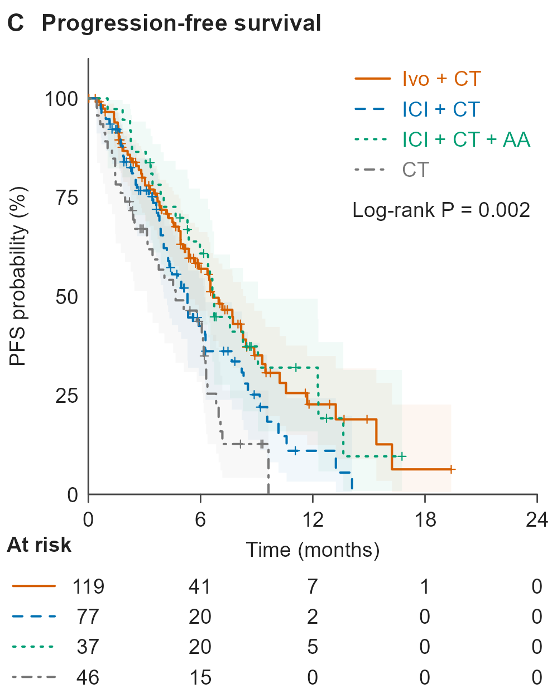

# 四治疗组 PFS Kaplan–Meier 生存曲线

[PDF 原件](20261106_clinical_km-pfs_four-treatment-groups_Figure_1C_v01.pdf) · [PNG 原件](20261106_clinical_km-pfs_four-treatment-groups_Figure_1C_v01.png)

## 识别与来源

- 原始文件名：`Figure_1C.pdf`、`Figure_1C.png`。
- 主分类：`clinical/03_survival_analysis`。
- 图形类型：four-group Kaplan-Meier PFS plot with risk table。
- 检索关键词：Kaplan-Meier; KM; PFS; progression-free survival; log-rank; censoring; number at risk; 四组生存曲线; 无进展生存。
- 来源：用户于 2026-11-06 上传，并明确要求收录至本仓库；图号沿用原文件名。论文引用、DOI、发表状态及原始代码未提供。
- 软件：原始绘图软件未知。PDF 元数据中的输出程序为 cairo 1.18.4；这不证明使用了某个具体 R/Python 包。
- 许可状态：unknown；用户授权本次仓库归档，不代表已核实对外再使用许可。
- 文件校验：参见 [本批原件清单](../../sources/20261106_clinical_upload_manifest.json)，收录时保持原文件字节不变。

## 图面确认的内容

- 比较 Ivo + CT、ICI + CT、ICI + CT + AA、CT 四组 PFS；时间单位为月，纵轴为生存概率百分比。
- 阶梯曲线、不同颜色与线型、删失标记、半透明置信带、总体 Log-rank P 和与横轴刻度对齐的风险表。
- 图面时间范围 0–24 月，风险表间隔 6 月；这些范围只属于此参考图。

## 复用时需要的当前项目数据

- 每位分析对象的标识、治疗组、PFS 时间、PFS 事件状态；延迟入组时还需要入组时间。
- 当前研究的时间起点、进展/死亡事件定义、末次随访与删失规则、缺失处理、分析集定义。

## 给 Codex 的分析与绘图要点

以下为未来任务的工作要点，不是对原图未提供方法的推断。

1. 先核对时间单位、起点、事件编码以及每组有效人数，明确分析单位和分析集。
2. 从当前个体级数据估计各组 KM 曲线、置信带、删失标记及指定时点的风险人数。
3. 依当前分析方案执行总体 log-rank 检验；多组总体 P 值不能代替任意两组比较。
4. 需要 HR 时另行定义 Cox 模型、参考组与调整变量，并检查模型适用性；不能从 KM 图面得到调整后治疗效应。
5. 固定颜色和线型映射；风险表与主图使用相同时间刻度；根据当前随访长度设置横轴与展示范围。

## 限制与核对事项

- 原始数据、代码和置信带计算设置未提供；展示了置信带不等于已核实其置信水平。
- 图中起始风险人数与其他终点的分母可能不同；不得复制参考图的 n、P 值、曲线或结论。
- 本次仅归档视觉参考和说明，没有对原始研究数据重新分析；图片中的数值、样本量、统计结果和研究结论不可迁移到新任务。

## 关联示例

[Figure_1A：四治疗组客观缓解率（ORR）柱状图](../04_treatment_response/20261106_clinical_orr-bar_four-treatment-groups_Figure_1A_v01.md)；[Figure_2A：按 PD-L1 三分组的 OS Kaplan–Meier 曲线](../03_survival_analysis/20261106_clinical_km-os_pdl1-three-strata_Figure_2A_v01.md)；[Figure_S6A：TP53 变异状态与 PFS 的双组 KM 曲线](../03_survival_analysis/20261106_clinical_km-pfs_tp53-alteration_Figure_S6A_v01.md)。

[返回临床图形导航](../README.md)
