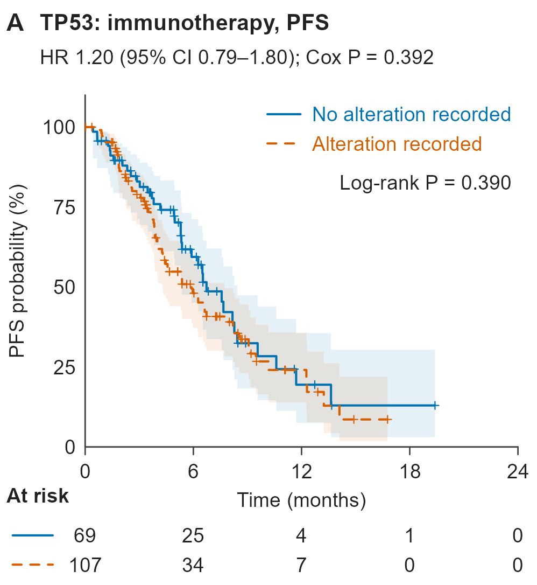

# TP53 变异状态与 PFS 的双组 KM 曲线

[PNG 原件](20261106_clinical_km-pfs_tp53-alteration_Figure_S6A_v01.png)

## 识别与来源

- 原始文件名：`Figure_S6A.png`。
- 主分类：`clinical/03_survival_analysis`。
- 图形类型：two-group biomarker Kaplan-Meier PFS plot with Cox HR annotation。
- 检索关键词：Kaplan-Meier; KM; TP53; PFS; Cox; HR; log-rank; altered versus reference; 双组生存曲线; 基因变异。
- 来源：用户于 2026-11-06 上传，并明确要求收录至本仓库；图号沿用原文件名。论文引用、DOI、发表状态及原始代码未提供。
- 软件：原始绘图软件未知。仅有 PNG，不能确定原始软件或绘图包。
- 许可状态：unknown；用户授权本次仓库归档，不代表已核实对外再使用许可。
- 文件校验：参见 [本批原件清单](../../sources/20261106_clinical_upload_manifest.json)，收录时保持原文件字节不变。

## 图面确认的内容

- 两组明确标为 No alteration recorded 与 Alteration recorded，以蓝色实线和橙色虚线区分。
- 上方单独给出 HR、95% CI 和 Cox P；图内另列 Log-rank P，底部带风险表。
- 图面起始风险人数为 69 与 107；与同批 Figure_S4A 的 TP53 行相呼应。

## 复用时需要的当前项目数据

- 分析单位标识、PFS 时间/事件、TP53 变异记录、检测覆盖与缺失状态、目标分析集标记。
- 当前方案中的变异分组规则、Cox 对比方向、调整变量和时间/事件定义。

## 给 Codex 的分析与绘图要点

以下为未来任务的工作要点，不是对原图未提供方法的推断。

1. 区分已检测且未发现变异、未记录变异及未检测/未知；只有当前数据能支持时才将参考组称为野生型。
2. 用当前数据绘制双组 KM 曲线、置信带、删失标记与风险表。
3. 独立计算并明确标注 Cox HR、95% CI、Cox P 与 log-rank P；根据预设对比确定 HR 方向。
4. 核对 Cox 模型、协变量与适用性；图面不足以确定参考结果是否经多变量调整。

## 限制与核对事项

- 仅上传 PNG；没有同名 PDF 或原始绘图代码。
- 不能根据组名将 No alteration recorded 自动等同于经完整检测证实的 wild type。
- 同图中的 Cox P 与 log-rank P 来自不同检验，不要求数值相等。
- 本次仅归档视觉参考和说明，没有对原始研究数据重新分析；图片中的数值、样本量、统计结果和研究结论不可迁移到新任务。

## 关联示例

[Figure_S4A：多基因变异与 PFS 关联的 Cox 森林图](../05_forest_plots_subgroup/20261106_clinical_cox-forest_gene-alteration-pfs_Figure_S4A_v01.md)；[Figure_2A：按 PD-L1 三分组的 OS Kaplan–Meier 曲线](../03_survival_analysis/20261106_clinical_km-os_pdl1-three-strata_Figure_2A_v01.md)。

[返回临床图形导航](../README.md)
