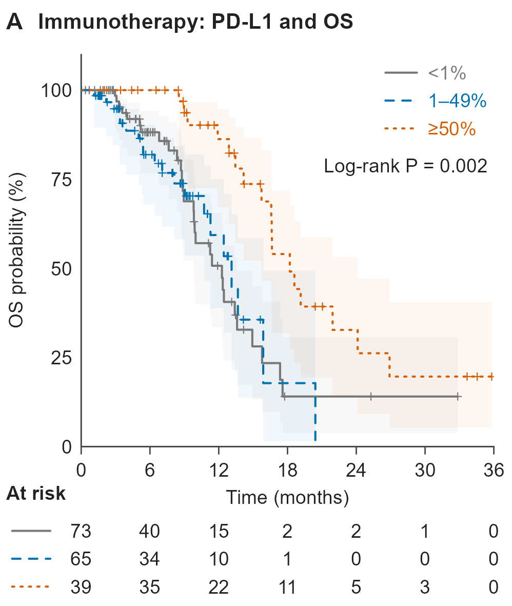

# 三组 KM 生存曲线

[PDF 原件](km_three_group.pdf) · [PNG 原件](km_three_group.png)

## 识别与来源

- 图形类型标识：`km_three_group`。
- 主分类：`clinical/03_survival_analysis`。
- 图形类型：three-stratum biomarker Kaplan-Meier OS plot with risk table。
- 检索关键词：Kaplan-Meier; KM; OS; PD-L1; biomarker stratification; log-rank; 三分组; 生物标志物; 总生存。
- 来源：用户于 2026-11-06 上传，并明确要求收录至本仓库；原始文件名仅在来源清单中保留以便追溯。论文引用、DOI、发表状态及原始代码未提供。
- 软件：原始绘图软件未知。PDF 元数据中的输出程序为 cairo 1.18.4；这不证明使用了某个具体 R/Python 包。
- 许可状态：unknown；用户授权本次仓库归档，不代表已核实对外再使用许可。
- 文件校验：参见 [本批原件清单](../../sources/20261106_clinical_upload_manifest.json)，收录时保持原文件字节不变。

## 当前示例背景

当前示例展示 PD-L1 三分层 OS，含置信带、删失标记和风险表。

图形类型可以复用于其他终点、分组或基因；请按当前数据重新定义分析变量。

## 图面确认的内容

- 标题为 Immunotherapy: PD-L1 and OS，按 <1%、1–49%、≥50% 三层分组。
- 灰、蓝、橙分别配合不同线型，包含删失标记、半透明置信带、总体 log-rank P 和风险表。
- 图面时间范围为 0–36 月，起始风险人数为 73、65、39。

## 复用时需要的当前项目数据

- 分析单位标识、OS 时间和死亡事件状态、PD-L1 数值或已确认的分层变量、免疫治疗分析集标记。
- PD-L1 检测方法、取材时点、缺失处理，以及当前方案中的分层阈值与 OS 定义。

## 给 Codex 的分析与绘图要点

以下为未来任务的工作要点，不是对原图未提供方法的推断。

1. 根据当前方案定义分析集和分层阈值；若使用此图阈值，应明确 <1、1 至 <50、≥50 的边界以及缺失者处理。
2. 使用当前数据估计各组 KM 曲线、置信带与风险表，执行预设的总体或成对比较。
3. 若增加 Cox 分析，明确参考层、协变量与模型检查；不能仅因参考图出现一个 P 值就默认其模型设置。
4. 保持分层顺序、颜色、线型及风险表对应，并说明总体检验和成对检验的区别。

## 限制与核对事项

- 按图形结构主归档至生存分析，生物标志物目录通过导航交叉检索。
- 这种组内生存关联图本身不能确立预测性生物标志物；评价治疗获益差异需要合适的对照与交互分析。
- 置信带水平、临床调整变量及缺失者处理无法从图片确认。
- 本次仅归档视觉参考和说明，没有对原始研究数据重新分析；图片中的数值、样本量、统计结果和研究结论不可迁移到新任务。

## 关联示例

[四组 KM 生存曲线](../03_survival_analysis/km_four_group.md)；[双组 KM 生存曲线（附 Cox HR）](../03_survival_analysis/km_two_group_cox.md)；[基因变异谱 Oncoprint](../06_biomarkers/oncoprint.md)。

[返回临床图形导航](../README.md)
