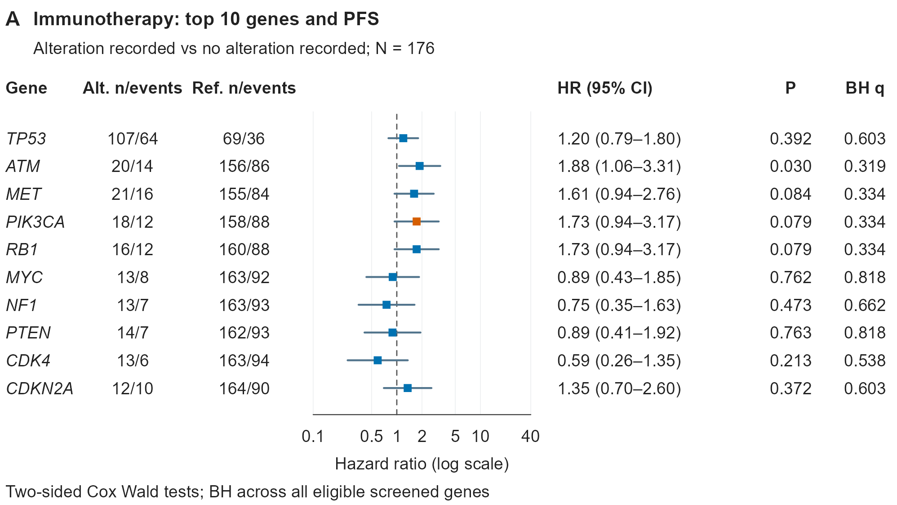

# 多基因变异与 PFS 关联的 Cox 森林图

[PDF 原件](20261106_clinical_cox-forest_gene-alteration-pfs_Figure_S4A_v01.pdf) · [PNG 原件](20261106_clinical_cox-forest_gene-alteration-pfs_Figure_S4A_v01.png)

## 识别与来源

- 原始文件名：`Figure_S4A.pdf`、`Figure_S4A.png`。
- 主分类：`clinical/05_forest_plots_subgroup`。
- 图形类型：gene-wise Cox association forest plot with HR confidence intervals and BH q values。
- 检索关键词：forest plot; Cox regression; HR; log scale; BH; FDR; gene screening; n/events; 森林图; 基因关联; 多重检验。
- 来源：用户于 2026-11-06 上传，并明确要求收录至本仓库；图号沿用原文件名。论文引用、DOI、发表状态及原始代码未提供。
- 软件：原始绘图软件未知。PDF 元数据中的输出程序为 cairo 1.18.4；这不证明使用了某个具体 R/Python 包。
- 许可状态：unknown；用户授权本次仓库归档，不代表已核实对外再使用许可。
- 文件校验：参见 [本批原件清单](../../sources/20261106_clinical_upload_manifest.json)，收录时保持原文件字节不变。

## 图面确认的内容

- 展示 10 个基因的 HR 与 95% CI，比较方向写为 Alteration recorded vs no alteration recorded。
- 左侧为 Gene、Alt. n/events、Ref. n/events；中间为对数 HR 轴和 HR=1 虚线；右侧为 HR（95% CI）、P、BH q。
- PIK3CA 点以橙色强调，其余为蓝色；图下注明双侧 Cox Wald 检验，BH 覆盖所有符合条件的筛选基因。

## 复用时需要的当前项目数据

- 个体级生存数据、基因检测/变异状态、候选基因集合、分析集定义；或已经验证的逐基因模型结果表。
- 结果表至少包括 gene、两组人数/事件数、HR、CI 下限/上限、P、BH q、对比方向、模型及协变量说明。

## 给 Codex 的分析与绘图要点

以下为未来任务的工作要点，不是对原图未提供方法的推断。

1. 预先定义符合条件的基因、变异与未知值编码及模型方案，报告各基因可用人数与事件数。
2. 从当前数据拟合指定的逐基因 Cox 模型，记录对比方向、置信区间、检验类型及模型检查。
3. 按预设的完整检验家族进行 BH 校正；展示 Top 10 不意味着只对这 10 个 P 值校正。
4. 在对数轴上绘制 HR 和置信区间，设置 HR=1 参考线，并将各行样本数、事件数、数值与图形对齐。
5. 突出某个基因时说明依据；颜色强调不能替代显著性判断。

## 限制与核对事项

- 这是逐基因生存关联森林图，图面未提供治疗×基因交互项，不应称为治疗效应异质性或治疗亚组交互森林图。
- 原图未说明 Cox 是否调整临床协变量；不能自动标记为单因素或多因素分析。
- 只凭图中的 10 个 P 值无法复算覆盖完整筛选基因集合的 BH q。
- 本次仅归档视觉参考和说明，没有对原始研究数据重新分析；图片中的数值、样本量、统计结果和研究结论不可迁移到新任务。

## 关联示例

[Figure_S6A：TP53 变异状态与 PFS 的双组 KM 曲线](../03_survival_analysis/20261106_clinical_km-pfs_tp53-alteration_Figure_S6A_v01.md)；[Figure_4A：伴随基因变异谱与临床注释 Oncoprint](../06_biomarkers/20261106_clinical_oncoprint_genomic-alterations_Figure_4A_v01.md)；[Figure_4B：基因变异频率的治疗组汇总热图](../06_biomarkers/20261106_clinical_frequency-heatmap_genes-by-treatment_Figure_4B_v01.md)。

[返回临床图形导航](../README.md)
