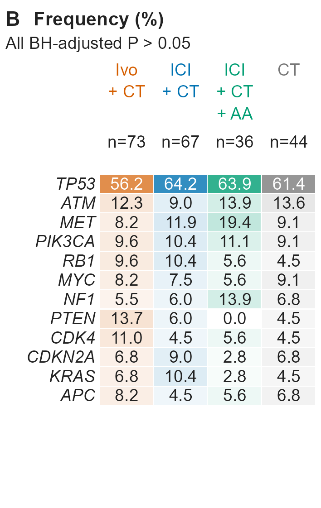

# 基因变异频率的治疗组汇总热图

[PNG 原件](20261106_clinical_frequency-heatmap_genes-by-treatment_Figure_4B_v01.png)

## 识别与来源

- 原始文件名：`Figure_4B.png`。
- 主分类：`clinical/06_biomarkers`。
- 图形类型：annotated gene alteration frequency heatmap by treatment group。
- 检索关键词：frequency heatmap; gene alteration; percentages; annotated heatmap; BH adjustment; 基因频率; 分组热图; 百分比矩阵。
- 来源：用户于 2026-11-06 上传，并明确要求收录至本仓库；图号沿用原文件名。论文引用、DOI、发表状态及原始代码未提供。
- 软件：原始绘图软件未知。仅有 PNG，不能确定原始软件或绘图包。
- 许可状态：unknown；用户授权本次仓库归档，不代表已核实对外再使用许可。
- 文件校验：参见 [本批原件清单](../../sources/20261106_clinical_upload_manifest.json)，收录时保持原文件字节不变。

## 图面确认的内容

- 行是基因，列是四个治疗组；每格显示变异频率百分比，列上方标注 n=73、67、36、44。
- 各列沿用治疗组橙、蓝、绿、灰色系；格内数字便于直接比较频率。
- 顶部写有 All BH-adjusted P > 0.05；图面没有注明原始检验类型、各基因 P/q 值或完整校正家族。

## 复用时需要的当前项目数据

- 每组每基因的变异人数及可评估分母，或具有检测状态的个体级变异记录；同时保留各组标签。
- 基因集合、基因检测覆盖规则、组间比较方法及多重检验家族的预设说明。

## 给 Codex 的分析与绘图要点

以下为未来任务的工作要点，不是对原图未提供方法的推断。

1. 按当前检测覆盖及分析单位定义，逐基因、逐组计算变异比例；缺失或未检测不能直接当作 0。
2. 仅在各基因共享相同可评估分母时使用单一列 n；否则报告逐基因分母或额外说明。
3. 根据当前数据和方案进行适当组间比较，再在明确的检验家族内做 BH 校正；不得照搬原图的总体文字结论。
4. 保留数字注释、单位和分母，明确颜色尺度。若希望直接比较跨组颜色深浅，采用统一色标；沿用分组色系时仍须保持统一数值映射。

## 限制与核对事项

- 这是汇总频率热图，没有患者级列；与 Figure_4A 的 Oncoprint 属于不同粒度的展示。
- 原图缺少明确连续色标，不能仅靠不同色系的视觉深浅推断精确数值。
- 只上传 PNG；没有同名 PDF。不能从 BH-adjusted P 的文字反推具体检验方法。
- 本次仅归档视觉参考和说明，没有对原始研究数据重新分析；图片中的数值、样本量、统计结果和研究结论不可迁移到新任务。

## 关联示例

[Figure_4A：伴随基因变异谱与临床注释 Oncoprint](../06_biomarkers/20261106_clinical_oncoprint_genomic-alterations_Figure_4A_v01.md)；[Figure_S4A：多基因变异与 PFS 关联的 Cox 森林图](../05_forest_plots_subgroup/20261106_clinical_cox-forest_gene-alteration-pfs_Figure_S4A_v01.md)。

[返回临床图形导航](../README.md)
