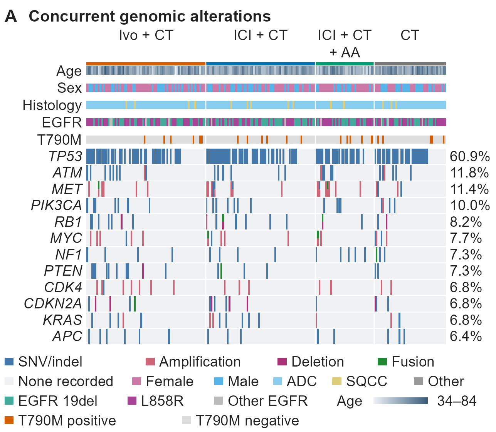

# 伴随基因变异谱与临床注释 Oncoprint

[PDF 原件](20261106_clinical_oncoprint_genomic-alterations_Figure_4A_v01.pdf) · [PNG 原件](20261106_clinical_oncoprint_genomic-alterations_Figure_4A_v01.png)

## 识别与来源

- 原始文件名：`Figure_4A.pdf`、`Figure_4A.png`。
- 主分类：`clinical/06_biomarkers`。
- 图形类型：oncoprint genomic alteration matrix with clinical annotation tracks。
- 检索关键词：oncoprint; oncoplot; genomic alterations; mutation landscape; clinical annotation; EGFR; 基因变异谱; 突变瀑布图; 临床注释。
- 来源：用户于 2026-11-06 上传，并明确要求收录至本仓库；图号沿用原文件名。论文引用、DOI、发表状态及原始代码未提供。
- 软件：原始绘图软件未知。PDF 元数据中的输出程序为 cairo 1.18.4；这不证明使用了某个具体 R/Python 包。
- 许可状态：unknown；用户授权本次仓库归档，不代表已核实对外再使用许可。
- 文件校验：参见 [本批原件清单](../../sources/20261106_clinical_upload_manifest.json)，收录时保持原文件字节不变。

## 图面确认的内容

- 按四个治疗组分隔列，顶部为组别色条；行展示基因，列展示匿名样本的基因变异模式。
- 上方注释包括 Age、Sex、Histology、EGFR、T790M；不同颜色标识 SNV/indel、Amplification、Deletion、Fusion。
- 右侧标注各基因变异频率；年龄使用连续色带，其他注释使用分类色块。

## 复用时需要的当前项目数据

- 样本/患者与分析单位对应表、治疗组和临床注释，以及包含 sample_id、gene、alteration_type 的变异长表或等价矩阵。
- 检测覆盖/未检测/缺失标记、多事件编码规则、基因筛选与排序规则、频率计算分母。

## 给 Codex 的分析与绘图要点

以下为未来任务的工作要点，不是对原图未提供方法的推断。

1. 先确认一列代表患者还是样本、同一患者是否可能重复，明确各基因检测覆盖与频率分母。
2. 建立可保留同一基因多个变异类型的编码，区分未记录、未检出和未检测状态。
3. 按治疗组分块，再按当前项目确定的规则排序；临床注释、变异矩阵和频率统计使用同一列顺序。
4. 按已确认的分母计算基因频率，分别设置变异类型图例、分类注释图例和年龄连续图例。

## 限制与核对事项

- 图形为基因变异 Oncoprint，不是肿瘤体积变化的疗效瀑布图。
- 图面没有明确检测分母与列的生物学单位；实际复用时需查当前数据字典。
- None recorded 不自动等同于所有基因均已充分检测且阴性；T790M 等标签的含义也需由当前数据确认。
- 本次仅归档视觉参考和说明，没有对原始研究数据重新分析；图片中的数值、样本量、统计结果和研究结论不可迁移到新任务。

## 关联示例

[Figure_4B：基因变异频率的治疗组汇总热图](../06_biomarkers/20261106_clinical_frequency-heatmap_genes-by-treatment_Figure_4B_v01.md)；[Figure_S4A：多基因变异与 PFS 关联的 Cox 森林图](../05_forest_plots_subgroup/20261106_clinical_cox-forest_gene-alteration-pfs_Figure_S4A_v01.md)；[Figure_2A：按 PD-L1 三分组的 OS Kaplan–Meier 曲线](../03_survival_analysis/20261106_clinical_km-os_pdl1-three-strata_Figure_2A_v01.md)；[Figure_S6A：TP53 变异状态与 PFS 的双组 KM 曲线](../03_survival_analysis/20261106_clinical_km-pfs_tp53-alteration_Figure_S6A_v01.md)。

[返回临床图形导航](../README.md)
