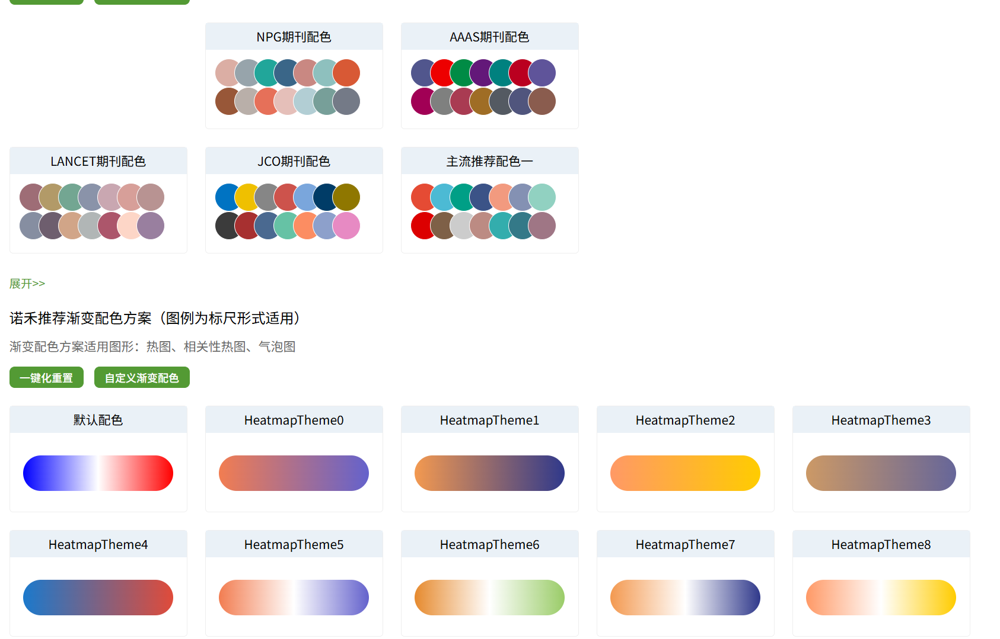

# 期刊离散配色与热图渐变配色参考

- **文件名：** `20261028_shared_color-palettes_journal-and-heatmap_v01.png`
- **分类：** shared / 01_color_palettes
- **图形类型：** 分类变量离散色板、连续变量渐变色带
- **用途：** 为临床研究、单细胞/空间组学绘图提供配色设计参考。
- **来源：** 用户于 2026-10-28 在对话中上传的 `image.png`；原始网页、作者及 URL 未提供。
- **图号 / 软件：** unknown
- **许可状态：** unknown；用户要求将本截图收录到此仓库，原始来源的转载和再使用许可未核实。
- **添加日期：** 2026-10-28

## 截图中可见的方案

| 类型 | 截图中的名称 | 可借鉴的设计 |
| --- | --- | --- |
| 离散色板 | NPG期刊配色、AAAS期刊配色、LANCET期刊配色、JCO期刊配色、主流推荐配色一 | 分类变量的颜色组合，以及圆形色块排列的预览方式 |
| 渐变色带 | 默认配色、HeatmapTheme0–HeatmapTheme8 | 双端渐变与带浅色中点的渐变，适用于热图、相关性热图、气泡图等连续数值映射 |

截图另有“展开”“一键化重置”“自定义渐变配色”等界面元素；这里只收录静态视觉参考，不代表仓库提供这些交互功能。

## 使用建议与限制

- 类别配色可参考用于分组、细胞类型及注释条；同一研究内应固定颜色与类别的对应关系。
- 连续色带应结合数据含义选择：单向强度优先选用亮度有序的顺序色带；相关系数、以零为中心的变化或 Z-score 可使用具有明确中点的发散色带。
- 保留项目已有的临床或生物学颜色语义，实际使用时检查颜色区分度、色觉可访问性及图例可读性。
- 截图顶部有裁切，仅记录清晰可见的方案，不推测折叠内容。
- 期刊名称及“诺禾推荐”等均为截图界面文字；不能据此认定为期刊官方标准或已核实的来源。
- 本次未提取 HEX 色值。截图中的像素颜色可能受显示与图像处理影响，不能将视觉近似值当作原始调色板参数。
- 本图不包含研究数据或统计结果，仅用于学习配色与预览布局。

## 原始文件校验

- 格式与尺寸：PNG，1686 × 1079 像素。
- 文件大小：286887 字节；按原文件保存，未裁切或重编码。
- SHA-256：`209bf77a064cd3a8b02d5851110895678d681cc6429a7ebf97164d58bf187ae1`。
